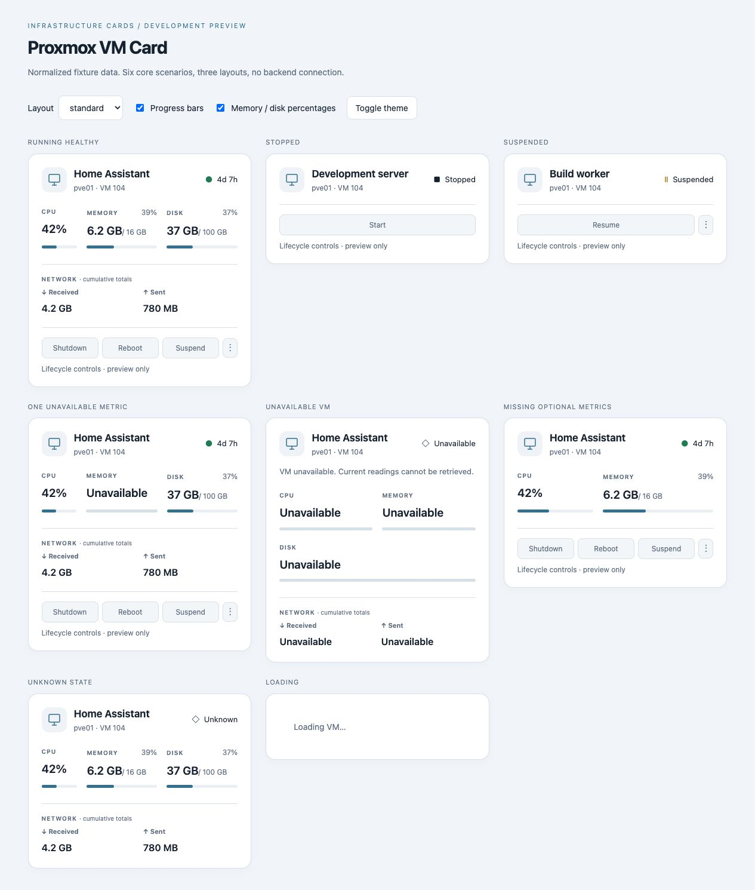
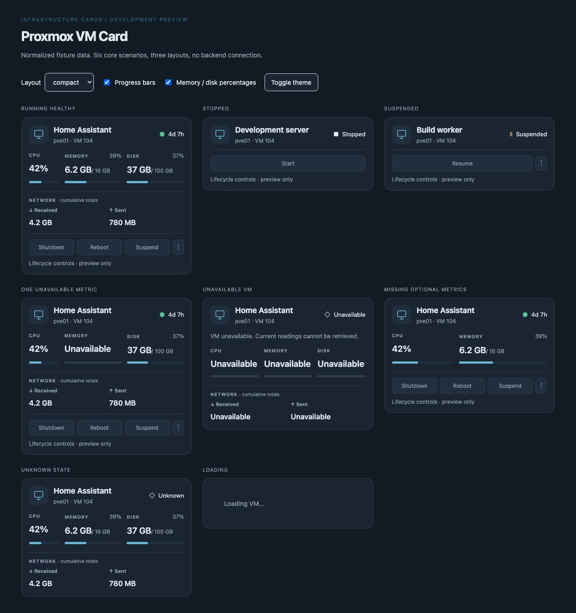
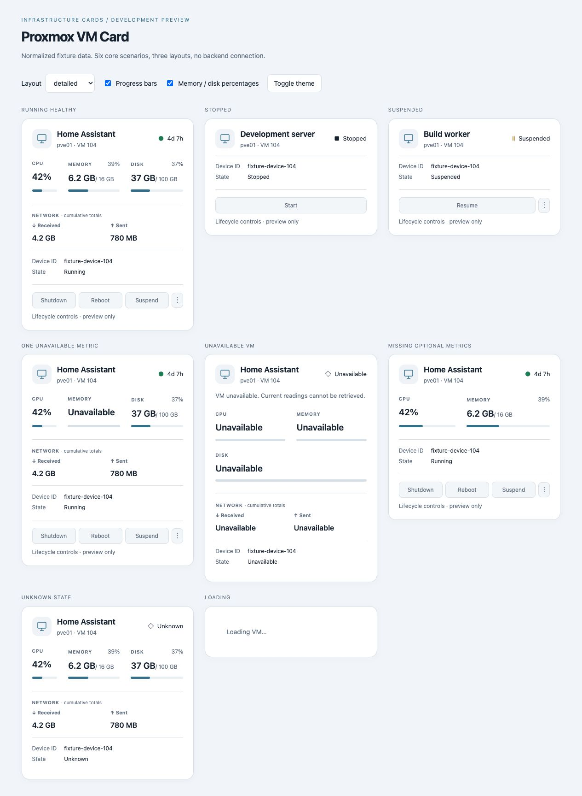

# Proxmox Cards for Home Assistant

A Home Assistant card for monitoring and controlling QEMU VMs through the **official Home Assistant Proxmox VE integration**.

Local-first: Home Assistant remains the backend. The card has no cloud backend or telemetry and never connects directly to Proxmox.

**Status:** the VM card's monitoring, lifecycle controls and visual editor are implemented. Available in the HACS default catalog. This is an early release; try it on a test dashboard before using it for important VMs.

## Features

- Device-first configuration and automatic official-integration discovery.
- CPU, RAM, disk, cumulative network totals and running uptime.
- Compact, standard and detailed layouts; responsive sizing and HA light/dark themes.
- Start, Shutdown, Reboot, Suspend, Resume and separate Force Stop controls, subject to HA capability/state/permissions.
- Configurable confirmations, metric/action visibility and tap/hold/double-tap actions.
- Visual editor, explicit administrator onboarding for disabled metrics, advanced discovery diagnostics and safe sensor overrides.
- Unavailable placeholders and action errors; stopped/suspended VMs collapse telemetry.

## Screenshots

Actual captures from the local fixture harness, using fictional VM/node/device identifiers. Lifecycle controls are inert; no deployment data appears in these images.

**Standard · light theme**



<details>
<summary>Compact layout · dark theme</summary>



</details>

<details>
<summary>Detailed layout · light theme</summary>



</details>

## Requirements

- Home Assistant with the **official `proxmoxve` integration** configured.
- A QEMU VM device; LXC, nodes, storage and custom/HACS Proxmox integrations are not supported by this card.
- Browser support for current Home Assistant frontend components. A minimum HA version has not yet been established for a release.

Some bundled Home Assistant versions may report suspended QEMU VMs as running. The optional local workaround in `tools/ha-proxmox-paused-status.py` changes the integration and requires review after Home Assistant upgrades; it is not installed by the card.

## Installation

### HACS

1. Open **HACS** and search for **Proxmox Cards for Home Assistant**.
2. Open the result and download the release.
3. Reload the Home Assistant browser, then add **Proxmox VM Card** to a dashboard.

If your HACS catalog has not refreshed yet, you can add `https://github.com/chsegala/proxmox-cards-for-home-assistant` under **HACS → ⋮ → Custom repositories**, choosing **Dashboard**, then search again.

If the card does not appear, check **Settings → Dashboards → ⋮ → Resources** for `/hacsfiles/proxmox-cards-for-home-assistant/proxmox-vm-card.js` with type **JavaScript module**. The Resources menu may require Advanced mode in your profile. YAML-managed dashboards may need the resource configured in YAML.

Install the official Proxmox VE integration separately under **Settings → Devices & services**. HACS installs the frontend card only.

### Manual installation

Download `proxmox-vm-card.js` from [Releases](https://github.com/chsegala/proxmox-cards-for-home-assistant/releases), copy it to `/config/www/proxmox-vm-card/`, and add `/local/proxmox-vm-card/proxmox-vm-card.js` as a JavaScript module resource.

Use one resource registration for this card. Remove an older manual registration when switching to HACS to avoid loading two versions.

### Updates and troubleshooting

Update through HACS and reload the browser. If old UI persists, hard-refresh the page and check for duplicate resource registrations. To roll back, use HACS's **Redownload** dialog to select an earlier release.

- **Custom element doesn't exist:** verify the resource path and module type, then reload the browser.
- **No supported VM found:** confirm that a QEMU VM belongs to the official `proxmoxve` integration; other integrations and LXC devices are unsupported.
- **Missing readings:** use the card editor to review disabled metric entities. Enabling them requires an administrator.
- **Suspended VM appears running:** this can be an integration limitation; see the note under Requirements.

## Configuration

Once the card resource is installed, choose **Add card → Proxmox VM Card** in dashboard edit mode. Select a VM and configure it visually; normal setup requires no YAML or sensor IDs.

Minimal YAML:

```yaml
type: custom:proxmox-vm-card
device: <home-assistant-device-id>
```

Optional settings:

```yaml
type: custom:proxmox-vm-card
device: <home-assistant-device-id>
title: Development VM
layout: detailed
icon: mdi:desktop-tower
state_accent: true
metrics:
  network: false
progress_bars:
  disk: false
memory_percentage: true
disk_percentage: true
actions:
  suspend: false
show_action_status: false
confirm:
  - shutdown
  - reboot
  - force-stop
  - suspend
tap_action:
  action: more-info
hold_action:
  action: navigate
  navigation_path: /my-dashboard/vms
double_tap_action:
  action: none
```

Omitted settings preserve product defaults. Metrics/actions default visible where discovered and usable. CPU always shows a percentage. Bars and memory/disk percentages default on. `progress_bars` also accepts a boolean. `confirm: []` removes confirmations; Start/Resume can be added. Force Stop remains in overflow. Errors remain visible even when ordinary action feedback is hidden.

Tap defaults to VM status More info (CPU as fallback); hold/double tap default to None. Gesture actions include navigation, URL, HA action/service, toggle and custom DOM events. Service actions execute with the current HA user's permissions; their confirmations are independent of lifecycle policy. Lifecycle controls do not trigger surface gestures.

**Advanced** exposes discovered IDs/statuses and optional `entities` sensor overrides for CPU, memory/total/percentage, disk/total, network RX/TX, uptime and status. Overrides must belong to the selected official VM device. Clearing an override restores automatic discovery.

When a configured metric requires disabled entities, the editor lists exactly what is needed. Only an explicit administrator click enables them. Partial/permission failures are shown; HA reloads can temporarily make readings unavailable. No values are fabricated during reload. Raw memory can be derived from enabled percentage and total sensors when raw usage is absent/disabled.

Network readings are decimal SI cumulative totals, not throughput. Actual disk semantics depend on HA's integration readings; the card does not query guest filesystems.

## Architecture

```text
Proxmox
  ↓
Home Assistant Proxmox VE integration
  ↓
HA device/entity registry and state
  ↓
Official adapter → normalized VM model → Proxmox VM Card
```

The card does not connect directly to Proxmox. Registry discovery, lifecycle/service interaction, normalized models, editor and presentation retain separate responsibilities. Discovery uses device metadata and exact semantic IDs, never fuzzy names.

## Development / manual testing

Requires Node.js **22.12+** and npm.

```sh
npm install
npm run dev
npm test
npm run lint
npm run typecheck
npm run build
npm run build:ha-preview
python3 tools/test_ha_proxmox_paused_status.py
```

The local fixture harness is deterministic and its power controls are inert. Switch layouts/themes and resize it. Production builds create `dist/proxmox-vm-card.js`, a self-contained module including Lit; fixtures are excluded.

For manual HA testing, copy that bundle to `/config/www/proxmox-vm-card/proxmox-vm-card.js` and register `/local/proxmox-vm-card/proxmox-vm-card.js` as a JavaScript module under dashboard resources. Use a separate test dashboard, refresh the resource URL version when rebuilding, and reload the browser. This is a development workflow, not a production release mechanism.

The separate `build:ha-preview` bundle registers inert fixture and live test tags. The fixture dashboard is in `dev/ha-test-dashboard.yaml`. Real lifecycle testing requires a disposable VM.

See [CONTRIBUTING](CONTRIBUTING.md) and [SECURITY](SECURITY.md).

## Status / roadmap

Implemented: QEMU VM monitoring/discovery, lifecycle controls, configuration/onboarding, diagnostics and surface gestures.

Deferred: Node/LXC/Storage/Cluster cards, history, throughput, backups and snapshots. No dates or commitment to future features are implied.

## License and independence

Repository code, foundation, adapters, editor, harness and tooling are licensed under [Apache-2.0](LICENSE). Third-party dependencies retain their own licenses. npm publication stays disabled (`private: true`).

This project is an independent community project and is not affiliated with or endorsed by Proxmox Server Solutions GmbH or the Home Assistant project.
